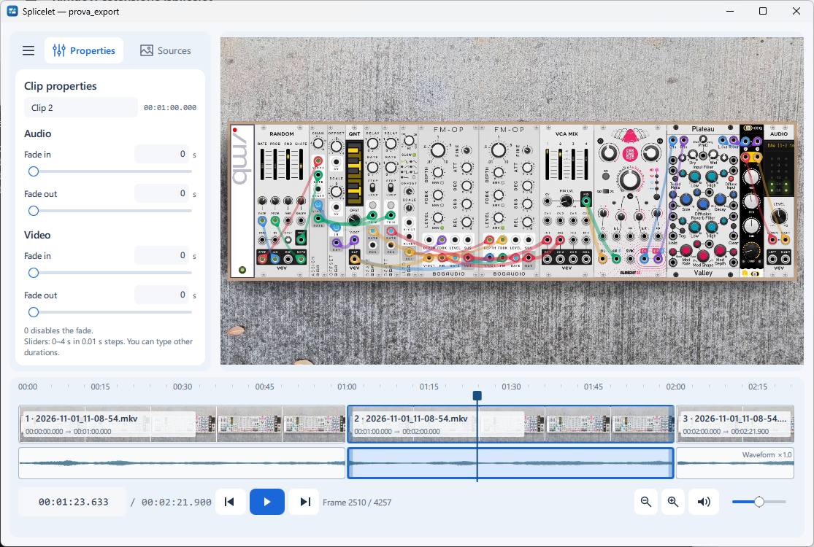

# Splicelet

A local Windows video editor for straightforward, non-destructive editing.
Built with Python, PySide6/QML, PyAV, NumPy and FFmpeg. All media processing
runs on your computer.



- Import multiple video/audio sources and arrange clips on linked or independent lanes.
- Split, trim, move, join and duplicate, with undo/redo and explicit gap removal.
- Use source waveforms, thumbnails, manual fades and automatic two-clip crossfades.
- Save projects and export H.264/AAC MP4, with optional sample-peak normalization.

## Quick start

Source development requires **64-bit Windows, PowerShell and Anaconda or Miniconda**.
From the repository root:

```powershell
powershell -NoProfile -File scripts/bootstrap.ps1
& '.\Launch Splicelet.cmd'
```

Bootstrap detects Conda and creates the pinned environment inside the repository.
If detection fails, pass its Python with `-CondaPython` as explained in
[setup](docs/DEVELOPMENT.md#environment-and-launch).
No media is bundled: import your own files with **Ctrl+I** or drop them onto the
preview. Originals are never modified; exports require a new destination.

## Documentation

- [User manual](docs/MANUAL.md): controls, editing, projects, export and current limits.
- [Architecture](docs/ARCHITECTURE.md): components, timing, data flow and design constraints.
- [Development](docs/DEVELOPMENT.md): environment, experimental portable build and checks.
- [Changelog](docs/CHANGELOG.md): version history. Help > About shows the running version.
- [Agent instructions](AGENTS.md): development and documentation maintenance rules.

Run the maintained test suite with
`powershell -NoProfile -File scripts/run-tests.ps1`. It generates synthetic media
locally; no personal recordings or video downloads are needed.

The project is currently distributed as source code only. Experimental portable
build scripts are provided for local use; prebuilt binaries are not published.

## License

Copyright (C) 2026 Massimo Barbieri.

Splicelet is free software licensed under the GNU General Public License,
version 3 or (at your option) any later version (`GPL-3.0-or-later`). See
[LICENSE](LICENSE) for the full terms. It is provided without warranty.
Third-party dependencies and material retain their respective licenses.
